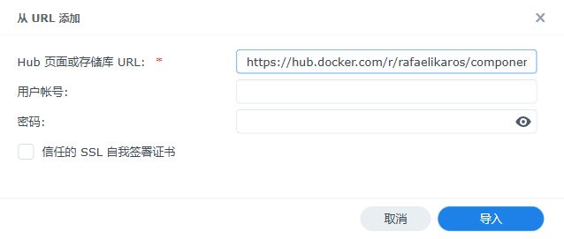
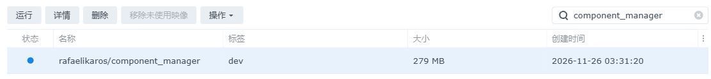
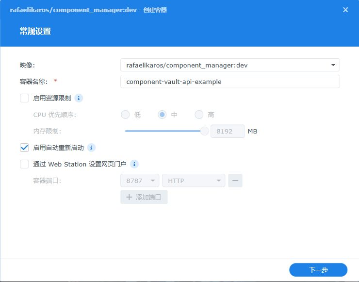
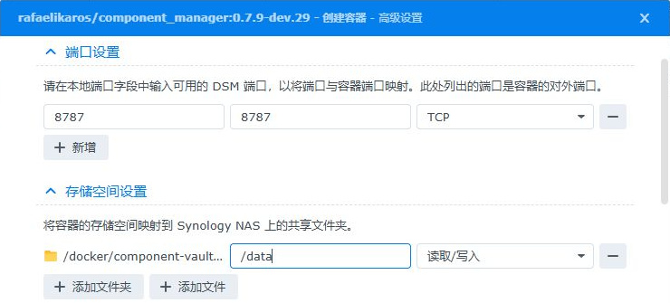
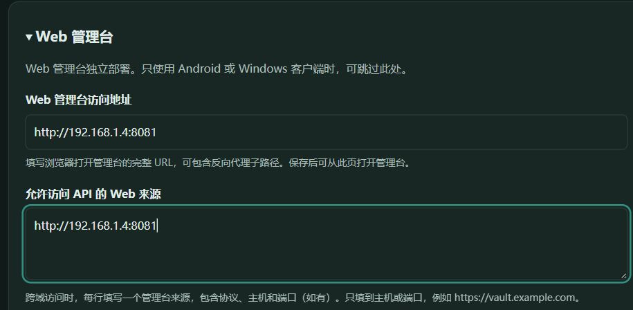
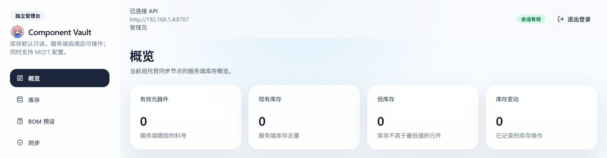
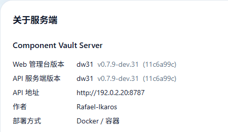

# 群晖 Container Manager 图文部署

在群晖的 **Container Manager → 映像**中创建 API 和 Web 两个独立容器，全程在 DSM 界面完成，无需 Compose、`.env`、SSH 或 Docker socket。只需要 Android 同步时，创建 API 并设置管理员密钥即可。

部署向导的截图拍摄于 `v0.7.9-dev.30`，镜像选择和更新步骤适用于 dev.31。截图里的 `192.168.1.4` 是示例，请换成自己的 NAS 地址。带 `-example` 的名称用于演示向导。已安装的用户可直接看[更新 API 容器](#更新-api-容器)。


## 1. 下载对应版本的镜像

在「镜像仓库」搜索 `rafaelikaros/component_manager`，按下表下载标签。`dev` 统一镜像只下载一次，后面用它创建两个容器。

| 要安装的版本 | API 标签 | Web 标签 | Web 的「命令」 |
| --- | --- | --- | --- |
| 跟随开发渠道 | `dev` | 使用同一个 `dev` | 填 `web` |
| 固定开发版，例如 dev.31 | `0.7.9-dev.31` | 使用同一个 `0.7.9-dev.31` | 填 `web` |
| 正式版 0.7.8 | `latest` | `web-latest` | 留空 |

统一镜像从 dev.30 开始提供。旧开发版按对应发布使用配套的 `web-*` 镜像。

**搜索提示无法连接时**，打开「映像 → 操作 → 导入 → 从 URL 添加」。粘贴下面的仓库地址，账号和密码留空，保留默认的证书验证。点击「导入」后，在列表中选择需要的标签。

```text
https://hub.docker.com/r/rafaelikaros/component_manager
```



下载完后在「映像」找到所选标签。下图中只有一个 `dev` 映像，选中它后可以点「运行」。



## 2. 创建 API 容器

**准备数据目录。** 新安装用 File Station 在 `docker` 共享文件夹下创建 `component-vault/data`。如果在升级，先[备份并记录旧挂载](#5-手动更新或切换渠道)，创建新容器时选择原目录。

1. 选中 API 映像，点「运行」。容器名称填 `component-vault-api`，可以勾选自动重新启动。「通过 Web Station 设置网页门户」保持未勾选，然后点「下一步」。

   

2. 在「高级设置」将本地端口和容器端口都填 `8787`，类型选 `TCP`。在「存储空间设置」点「添加文件夹」，选准备好的数据目录，装载路径填 `/data`，权限选「读取/写入」。

   

3. 新安装保留镜像的环境变量。网络选 `bridge`，高权限执行保持关闭。在「执行命令」中保留 Entrypoint，把「命令」留空。图里灰色的 `api` 是默认命令提示。

   

4. 点「下一步」。在摘要核对端口和 `/data` 后，勾选「向导完成后运行此容器」，点击「完成」。打开 `http://NAS地址:8787/health`，应看到 `"status":"ok"`。版本从同一响应的 `version` 查看。

## 3. 创建 Web 容器

1. 回到「映像」再点一次「运行」。开发版选刚才用过的 `dev`，正式版 0.7.8 选 `web-latest`。容器名称可填 `component-vault-web`，保持 Web Station 和高权限执行关闭。
2. 在「高级设置」把本地端口填 `8081`，**容器端口填 `80`**，类型选 `TCP`。如果预填了 `8787` 或 `8790`，改成 `80` 或删除预填行后新增。Web 的存储空间留空。

   

3. 网络选 `bridge`，Entrypoint 保留默认。**统一镜像在「命令」框填 `web`。** 正式版 `web-latest` 的命令框留空，沿用镜像自己的默认值。

   

4. 在摘要核对端口和命令，完成向导并启动。回到「容器」，两个容器应显示绿色运行状态，「项目」一栏显示 `-`。打开 `http://NAS地址:8081/`，应看到管理台登录页。

   

宿主机端口已被占用时，换一个空闲的**本地端口**。容器端口保持 API `8787`、Web `80`，下一节的浏览器地址也要换成实际使用的本地端口。

## 4. 设置管理员并登录

1. 打开 `http://NAS地址:8787/setup`，在「首次设置」生成或填写管理员 API Token，并保存到自己的密码管理器。新安装可以通过此页完成设置，容器环境变量无需新增 `API_TOKEN`。
2. 展开「Web 管理台（可选）」，**下面两个字段都要填**。服务端从第二项判断是否允许网页发起登录请求。

   | 字段 | 示例 |
   | --- | --- |
   | Web 管理台访问地址 | `http://NAS地址:8081/` |
   | 允许访问 API 的 Web 来源 | `http://NAS地址:8081`，只填协议、主机和端口 |

   

3. 需要在网页编辑、删除库存或办理出入库时，可开启「允许已登录的 Web 用户修改库存」。点击「保存并完成设置」。已有部署可以在 `/setup` 用当前管理员密钥登录后修改；配置了非空环境变量的字段以环境变量为准。
4. 打开 Web 登录页 `http://NAS地址:8081/`。**登录页的 API 地址填 `http://NAS地址:8787`**，输入刚保存的密钥。登录后应看到管理员身份和库存概览，新安装的库存统计为零。Android 同样填写 API 地址和对应账户密钥。

   

Web 和 API 使用同一主机名和协议，例如都用 IP，或都用同一域名。两个端口可以不同。普通用户使用各自的密钥，由管理员在[账户管理](accounts.md)中创建。

## 5. 手动更新或切换渠道


### 更新 API 容器

1. 在「容器」打开旧 API 的详情，记下实际映像 ID、宿主端口、`/data` 对应的宿主目录或卷、网络和自行设置的环境变量。如需导出设置，请妥善保存导出文件。
2. 暂停写入，在「容器」停止旧 API，再备份完整的 `/data`。备份需包含数据库及存在的 SQLite 辅助文件、`config.json`、`users/` 和各账户的照片目录。
3. 按[镜像选择表](#1-下载对应版本的镜像)下载目标 **API** 映像。跟随开发渠道选 `dev`，从固定版本升级时选择新的固定标签。DSM 若在「映像」中显示「有可用更新」，可通过「操作 → 更新」拉取同一标签的新映像。下载后记录新映像 ID。若 DSM 已用新映像重建并启动 API，跳到第 6 步核对版本。[群晖映像管理](https://kb.synology.com/en-us/DSM/help/ContainerManager/docker_image?version=7)
4. 如果旧容器还对应旧映像，在「映像」选刚下载的 API 映像，点「运行」，按[创建 API 容器](#2-创建-api-容器)重新创建。宿主端口沿用原值，容器端口是 `8787`。将**同一个宿主目录或卷**以读写方式挂回 `/data`。Entrypoint 和命令用新映像默认值。若保留旧容器以便回退，给新容器取不同名称并保持旧容器停止。
5. 跨版本重建时，带回自己设置且仍需使用的环境变量。dev.31 起，API 从镜像读取构建版本。目标是 dev.30 或更早版本时，省略旧容器的 `COMPONENT_VAULT_BUILD_VERSION` 和 `COMPONENT_VAULT_BUILD_REVISION`，以便目标镜像使用自己的默认值。保留原 `/data` 和有效设置即可沿用原账户密钥。
6. 启动后直连新 API 的 `http://NAS地址:8787/health`。若用了其他宿主端口，换成实际端口。核对 `status` 为 `ok`，`version` 和 `revision` 对应目标构建。只更新 API 的部署到这里即可。

### 更新 Web 管理台

停止旧 Web 后，按[创建 Web 容器](#3-创建-web-容器)从同一发布版本的新映像创建容器。开发版统一镜像的命令填 `web`，仍使用 `8081 → 80` 或原来的宿主端口。正式版配套 Web 镜像的命令留空。Web 容器无需挂载数据。

### 核对 Web 和 API 版本

刷新浏览器并打开「设置 → 关于服务端」。从 dev.31 起，**Web 管理台版本**是浏览器加载的网页版本，**API 服务端版本**来自当前连接的 API，**API 地址**是网页实际使用的地址。

以 dev.31 为例，两个容器都更新后，页面两栏均显示 `dw31`，直连 API 的 `/health` 返回 `"version":"v0.7.9-dev.31"`。`dw31` 是页面用的名称，拉镜像时使用上表中的标签。



截图使用发布版 Web 和示例 API，核对时请看自己页面上的地址。

| 核对结果 | 下一步 |
| --- | --- |
| 直连 `/health` 返回旧版 | 比对**运行中的 API 容器**和新下载的 API 映像 ID。ID 不同时回到[更新 API 容器](#更新-api-容器)。ID 相同且目标是 dev.30 或更早时，检查容器是否带入了上面提到的旧版本变量。 |
| 直连 `/health` 是新版，页面的 API 栏是旧版 | 对比页面的 API 地址与直连地址，核对端口和反向代理目标。有需要时重新登录并填写正确的 API 地址。 |
| API 已更新，页面的 Web 栏仍旧或没有独立版本栏 | 核对实际访问的 Web 容器是否使用新映像，并重新加载页面。经反向代理访问时，检查它所指向的 Web 容器。 |

确认版本后检查原账户与库存。若出现首次设置页或空库存，暂停写入并核对 API 的 `/data` 映射。检查通过后可清理已停止的旧容器和无引用的映像。

如果目标版本无法读取新版数据库，使用对应旧镜像和升级前的一致备份恢复。[备份与回退](docker-quickstart.md#6-升级前备份与回退)

## 分阶段排障

| 现象 | 核对步骤 |
| --- | --- |
| 「镜像仓库」搜索失败 | 试第 1 节的「从 URL 添加」。下载也失败时检查 NAS 网络及原始拉取错误。「映像」里已有同名标签时，核对它是否是本次下载的 Image ID。 |
| Web 容器启动后退出 | 检查所用标签、Entrypoint、启动命令和日志。用统一镜像时核对命令是 `web`，容器端口是 `80`。 |
| 日志提示 `exec /usr/local/bin/componentvault-entrypoint: no such file or directory` | 记录映像的 Image ID、容器实际入口和挂载目标。可用同一镜像、空闲宿主端口和第 3 节配置另建一个 Web 容器对照，无需挂载 API 数据。 |
| Web 页能打开，登录提示无法建立会话 | 在同一浏览器打开 API 的 `/health`。随后到 `/setup` 登录，确认「允许访问 API 的 Web 来源」有浏览器实际打开的 Web 地址，例如 `http://NAS地址:8081`。两个字段分别保存，填了管理台地址还需填允许来源。 |
| 更新后仍显示旧版本 | 按[核对 Web 和 API 版本](#核对-web-和-api-版本)依次查直连 API、运行中的容器映像 ID 和浏览器访问地址。 |

反馈问题时附上 DSM 版本、CPU 架构、映像 Image ID、实际 Entrypoint/命令和完整错误行。截图请遮盖 Token、Cookie 和敏感环境变量。

## 6. 网页一键更新是可选项

管理台的「检查更新」可用于查看版本。按本页创建的独立容器在 DSM 中手动更新。希望从网页重建容器时，使用 Compose 项目和[可选 Updater](server-web-update.md)，由 Updater 使用 Docker socket 管理本项目的容器。
