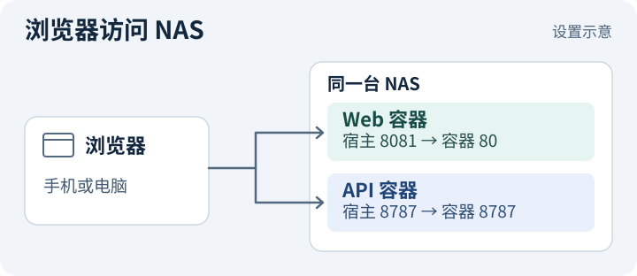
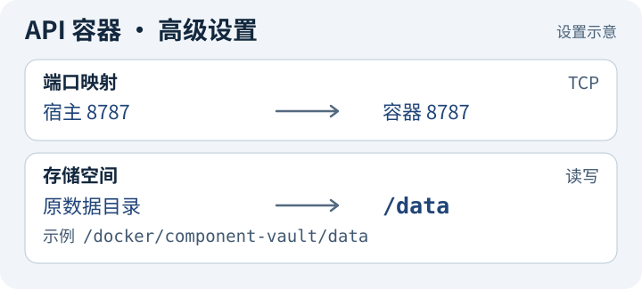
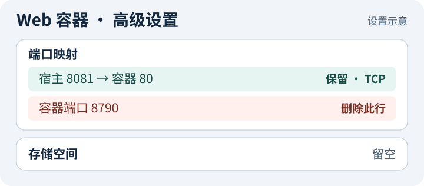
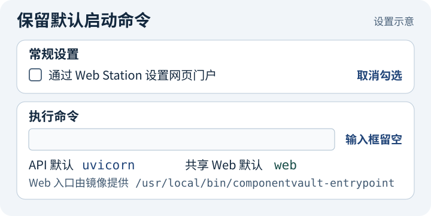
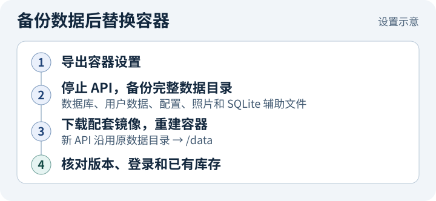

# 群晖手动部署：不使用 Compose

在群晖 Container Manager 中分别创建 API 和 Web 容器，即可使用库存、账户、同步、资料补全和版本检查。整个过程在 DSM 界面完成，无需项目 YAML、`.env`、SSH 或 Updater。

**2026-11-25 群晖实测（`linux/amd64`）。** 从 Docker Hub 重新下载 `dev` 和 `web-dev`，使用 DSM 向导创建独立容器并沿用原 `/data` 挂载。API 返回 `0.7.9-dev.29`，Web 可用原管理员密钥登录，原有账户、库存和 Web 配置可用，开发渠道检查更新正常。

**已有部署请先备份并记录原 `/data` 映射。** 替换 API 时沿用原数据来源和生效的环境变量。新建 `data` 目录仅适用于新安装。[备份与替换步骤](#5-手动更新或切换渠道)

## 1. 选择一组配套镜像

| 渠道 | API 镜像 | Web 镜像 |
| --- | --- | --- |
| 正式版 | `rafaelikaros/component_manager:latest` | `rafaelikaros/component_manager:web-latest` |
| 开发版 | `rafaelikaros/component_manager:dev` | `rafaelikaros/component_manager:web-dev` |

1. 打开 Container Manager 的「镜像仓库」（旧版称「注册表」），搜索 `rafaelikaros/component_manager`，下载表中同一行的两个标签。
2. 在侧栏「映像」确认下载完成。选中要部署的镜像，点击「运行」打开创建容器向导。先创建 API，再对 Web 重复操作。[群晖容器向导](https://kb.synology.com/en-my/DSM/help/ContainerManager/docker_container?version=7)

浮动标签下载后，现有容器仍使用创建时的镜像。若要固定版本，选择实际存在且版本号相同的 API、`web-` 标签，例如 `0.7.9-dev.29` 与 `web-0.7.9-dev.29`。[GitHub Releases](https://github.com/Rafael-Ikaros/Component_Manager/releases) · [Docker Hub Tags](https://hub.docker.com/r/rafaelikaros/component_manager/tags)

## 2. 创建 API 容器

新安装先在 File Station 创建持久化目录，例如共享文件夹 `docker` 下的 `/docker/component-vault/data`。已有部署使用原目录。

1. **常规设置。** 容器名可填 `component-vault-api`，按需开启自动重启，取消勾选「通过 Web Station 设置网页门户」。
2. **高级设置。** 将宿主 `8787` 映射到容器 `8787`（TCP），把持久化目录读写挂载到 `/data`。使用普通 `bridge` 网络，保持高权限执行关闭。新安装保留镜像默认环境变量，可稍后在 `/setup` 保存管理员密钥，无需添加 `API_TOKEN`。已有部署保留当前生效的自定义变量。
3. **执行命令与摘要。** 启动命令留空，使用镜像默认的 `uvicorn` 命令。核对端口、原 `/data` 来源和下表设置，完成后运行容器。

宿主 `8787` 被占用时，可换成其他空闲宿主端口。容器端口保持 `8787`，浏览器和客户端使用新宿主端口。

## 3. 创建 Web 容器

1. **常规设置。** 选择配套的 `web-*` 镜像，容器名可填 `component-vault-web`。按需开启自动重启，取消勾选「通过 Web Station 设置网页门户」。
2. **高级设置。** 共享管理镜像可能预列容器端口 `80` 和 `8790`。普通 Web 只保留宿主 `8081` → 容器 `80`（TCP），移除 `8790` 那一行。存储映射留空，使用普通 `bridge` 网络，保持高权限执行关闭。保留镜像继承的 `PATH`、`NGINX` 相关变量等默认值，无需新增环境变量。
3. **执行命令与摘要。** 启动命令输入框留空，使用镜像默认值。共享管理镜像的系统默认 Entrypoint 为 `/usr/local/bin/componentvault-entrypoint`，摘要显示「命令（系统默认） `web`」。入口路径由镜像提供，命令框既不填入口路径，也不填 `updater`。旧的 Web 专用镜像显示它自己的默认命令。
4. **运行。** 核对下表，完成后运行。先访问 `http://NAS地址:8081/`，确认能显示登录页。这一步只访问 Web 容器，不需要 API 先完成配置。

宿主 `8081` 被占用时，可换成其他空闲宿主端口。容器端口保持 `80`，Web 访问地址和 API 允许的 Web 来源都使用新宿主端口。

### 创建前核对

若「通过 Web Station 设置网页门户」稍后才显示，请在点击「下一步」前确认该选项未勾选。两个容器的命令输入框都留空。

| 设置 | API 容器 | Web 容器 |
| --- | --- | --- |
| 镜像 | 同一版本或渠道的 API 标签 | 对应的 `web-*` 标签 |
| 本地端口 → 容器端口 | `8787` → `8787`，TCP | `8081` → `80`，TCP |
| 挂载 | 原 API 数据目录 → `/data`，读写。新安装挂新建目录 | 无 |
| 环境变量 | 保留镜像默认值和已有生效的自定义值 | 保留镜像默认值 |
| 启动命令 | 留空，使用默认 `uvicorn` 命令 | 留空，使用默认 Web 命令 |
| 网络与权限 | `bridge`，关闭高权限和 Web Station 网页门户 | `bridge`，关闭高权限和 Web Station 网页门户 |

两个容器都无需挂载 Docker socket。Web 页面由浏览器访问 API，登录时填写浏览器能访问的 NAS 地址和 API 宿主端口。

## 4. 在网页保存配置

以下 `NAS地址` 换成浏览器实际访问 NAS 的 IP 或主机名；使用自己选择的本地端口。

1. 打开 `http://NAS地址:8787/setup`。新安装生成或填写管理员访问令牌并妥善保存。已有部署使用现行管理员密钥。
2. 将管理 Web 的允许来源设为 `http://NAS地址:8081`，管理 Web 地址也填写这个地址。如需在网页增删、批量更新库存，启用相应的 Web 库存操作选项。
3. 保存配置，API 会写入挂载目录中的 `/data/config.json`。已有部署的非空环境变量优先于文件，环境变量已接管的设置应从原部署配置核对。
4. 打开 `http://NAS地址:8081/`，API 地址填 `http://NAS地址:8787`，使用管理员令牌登录。
5. 确认库存页和设置页可以正常打开；Android 也填写同一个 API 地址及对应账户密钥。

Web 与 API 使用相同的 IP 或主机名、相同的 HTTP/HTTPS 协议，端口可以不同。API 允许的 Web 来源填写浏览器实际打开的 Web `协议://主机:端口`。手机和电脑填写能访问的 NAS 地址，`localhost` 指当前设备。通过反向代理访问时按浏览器看到的 Web 来源配置。[环境变量与连接说明](docker-quickstart.md#3-环境变量和网页配置的优先级)

管理员可随后创建普通账户，给各用户分发各自的密钥，详见[账户管理](accounts.md)。不要将管理员密钥发给所有用户。

## 5. 手动更新或切换渠道

1. 记录原 API、Web 的镜像和 Image ID、端口、挂载来源、网络和生效的自定义环境变量。在容器详情的「操作 → 导出」中选择「导出容器设置」，保存 API、Web 及已有 Updater 的恢复配置。设置导出不包含挂载的数据，仍须执行下一步的数据备份；包含密钥的文件保存在私有位置。
2. 暂停写入并停止 API，再备份宿主上完整的 API 数据目录。完整备份包括管理员数据库、`users/` 下的普通账户数据库、`config.json`、各账户 `.db.photos/` 及目录内的 SQLite `-wal`、`-shm` 等辅助文件。保留备份和原数据目录。
3. **需要清除旧镜像时**，先在「容器」中检查镜像的所有引用，包括已停止的容器。Web、测试容器和可选 Updater 可能共用管理镜像。备份相关有状态容器的数据，停止并移除本次需要替换的容器后，才在「映像」删除已无引用的目标镜像。其他项目及其引用的镜像保留。
4. 在 Container Manager 下载同一渠道的配套 API、Web 镜像。
5. 停止仍在运行的旧容器，再用下载的镜像创建替代容器。API 沿用原宿主目录 → `/data`、原端口和生效的环境变量。同一数据目录只允许一个 API 容器写入。若无需删除旧镜像，可先把旧容器保留在停止状态，便于核对原配置。
6. 用 API `/health` 核对版本，打开 Web 登录页并登录检查账户和库存。检查通过后，可移除不用的旧容器，选择保留持久化数据。

从已启用网页更新的项目改为本页的独立容器部署时，新 API 不再填写 `UPDATER_URL`，其余仍适用的自定义配置继续保留。旧 Updater 停止后，不要让 API 继续连接原来的 `http://updater:8790`。此部署的网页一键更新处于未启用状态，库存、同步和版本检查照常使用。

仅点「重新启动」会继续使用原容器的镜像。DSM 提供「重新创建」或类似功能时，在确认页核对新镜像和原 `/data` 映射。

若升级后出现初始化页或空库存，先停止写入、检查 `/data` 是否映射到了原目录，不在新空库中继续配置。镜像降级不会撤销数据库迁移；需要恢复时，使用对应镜像与一致的完整数据备份。备份和恢复边界见[升级说明](docker-quickstart.md#6-升级前备份与回退)。

网页“关于服务端”的渠道选择和“检查更新”只查询版本，不会替换容器。未启用网页一键更新是正常部署方式，不影响业务功能。

## 分阶段排障

| 现象 | 核对与处理 |
| --- | --- |
| 「镜像仓库」下载报错，或标签未出现在「映像」 | 检查仓库名、标签、NAS 网络和原始拉取错误。镜像完整出现在「映像」后，再进入创建容器向导。 |
| 容器启动即退出，日志显示 `exec /usr/local/bin/componentvault-entrypoint: no such file or directory` | 用同一映像新建一个独立的临时 Web 容器，仅映射空闲宿主端口到 `80`，保留镜像默认入口和命令，不挂载目录。对照两者的 Image ID、入口、命令、挂载与日志，记录是否复现。该测试只用 Web，无需操作 API 数据或开启高权限。 |
| Web 登录页已打开，连接 API 或登录失败 | 先从同一浏览器打开 API 的 `/health`。确认登录页填的是 API 宿主地址，再核对 API 允许来源是否与浏览器打开的 Web 来源完全一致。遇到 CORS 或会话 Cookie 错误时，使用同一主机及协议访问 Web 和 API，并核对当前生效的配置。[连接与 Cookie 说明](docker-quickstart.md#3-环境变量和网页配置的优先级) |

反馈启动问题时，请附上「映像」里的 Image ID（与容器 ID 是两项不同的值）、NAS 架构（如 `amd64` 或 `arm64`）、DSM 版本、容器实际 Entrypoint/Cmd、挂载的容器内目标和原始错误。请遮盖 Token、Cookie 和环境变量里的敏感值，避免发送环境变量或配置文件全文。

## 6. 网页一键更新是可选项

只有希望网页代替你重建 API、Web 容器时，才需要考虑 [Updater 配置](server-web-update.md)。当前 Updater 面向 Compose 项目，需要额外的 Docker socket 与部署目录挂载；直接创建的容器不能仅通过填写 `UPDATER_URL` 变成受支持的网页更新项目。

Docker socket 提供的权限不限于本项目。常见 root 模式下，控制 Docker 守护进程可以获得主机级能力，详见 [Docker 官方说明](https://docs.docker.com/engine/security/)。不希望授予该权限时，继续使用本页的手动更新即可；Watchtower 同样需要 Docker 管理访问，并非无权限替代方式。
