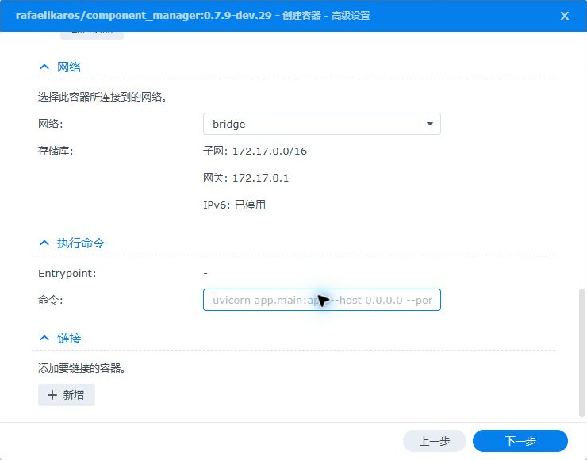
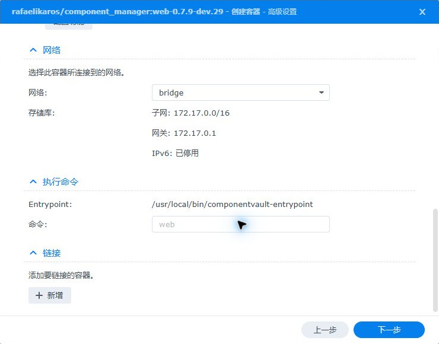
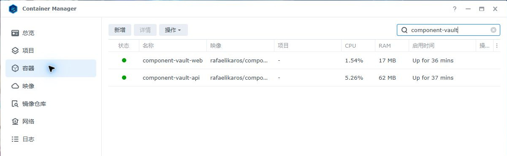
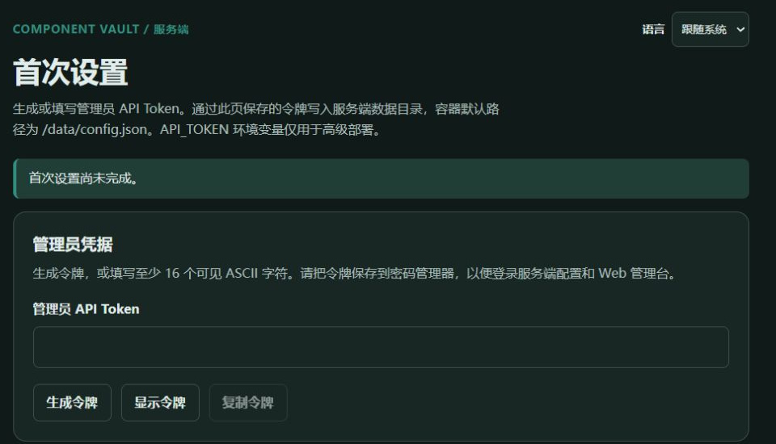
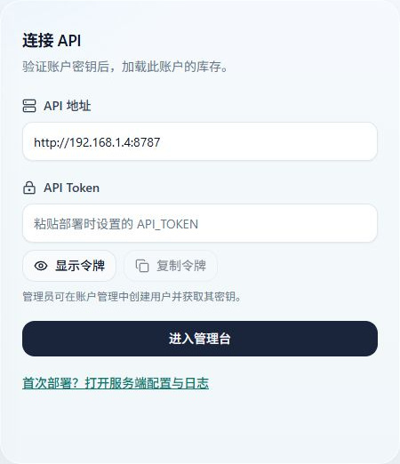

# 群晖手动部署：不使用 Compose

在群晖 Container Manager 中分别创建 API 和 Web 容器，即可使用库存、账户、同步、资料补全和版本检查。整个过程在 DSM 界面完成，无需项目 YAML、`.env`、SSH 或 Updater。

本文操作截图取自实际群晖界面，使用 `0.7.9-dev.29` 的配套镜像。截图中的版本、容器名称、目录和 IP 是本次操作示例；安装时按下面的说明替换为自己的设置。拓扑与备份流程图单独标为示意图。

**已有部署请先备份并记录原 `/data` 映射。** 替换 API 时沿用原数据来源和生效的环境变量。新建 `data` 目录仅适用于新安装。[备份与替换步骤](#5-手动更新或切换渠道)

## 1. 选择一组配套镜像

| 渠道 | API 镜像 | Web 镜像 |
| --- | --- | --- |
| 正式版 | `rafaelikaros/component_manager:latest` | `rafaelikaros/component_manager:web-latest` |
| 开发版 | `rafaelikaros/component_manager:dev` | `rafaelikaros/component_manager:web-dev` |

1. 打开 Container Manager 的「镜像仓库」（旧版称「注册表」），搜索 `rafaelikaros/component_manager`，下载表中同一行的两个标签。
2. 在侧栏「映像」确认两个镜像都已下载。下图使用固定版本 `0.7.9-dev.29` 和 `web-0.7.9-dev.29` 举例，按上表选择你要部署的配套标签即可。

   

若要固定版本，选择实际存在且版本号相同的 API、`web-` 标签。下载新镜像后，现有容器仍使用创建时的镜像。[GitHub Releases](https://github.com/Rafael-Ikaros/Component_Manager/releases) · [Docker Hub Tags](https://hub.docker.com/r/rafaelikaros/component_manager/tags)

## 2. 创建 API 容器

新安装先在 File Station 创建持久化目录，例如 `/docker/component-vault/data`，目录名可自定。已有部署沿用原数据目录。选中 API 镜像，点击「运行」打开创建容器向导。[群晖容器向导](https://kb.synology.com/en-my/DSM/help/ContainerManager/docker_container?version=7)

1. **常规设置。** 容器名可填 `component-vault-api`，截图中的 `component-vault-api-example` 是演示名称。自动重启按需开启。等「通过 Web Station 设置网页门户」出现后，确认未勾选，再点「下一步」。

   

2. **高级设置。** 将本地 `8787` 映射到容器 `8787`（TCP）。在「存储空间设置」选中数据目录，将容器路径填为 `/data`，权限选「读写」。新安装保留镜像默认环境变量，稍后在 `/setup` 保存管理员密钥即可。已有部署继续使用生效的自定义配置。

   

3. **网络和命令。** 选择 `bridge`，保持高权限执行关闭，命令输入框留空。灰色的 `uvicorn` 是镜像默认命令提示。核对端口和数据目录，完成创建并运行 API。

   

宿主 `8787` 被占用时，可换成其他空闲宿主端口。容器端口保持 `8787`，浏览器和客户端使用新宿主端口。

## 3. 创建 Web 容器

1. **常规设置。** 选中配套的 `web-*` 镜像，点击「运行」。容器名可填 `component-vault-web`，自动重启按需开启，保持「通过 Web Station 设置网页门户」未勾选。
2. **高级设置。** 只保留本地 `8081` → 容器 `80`（TCP）。若列表预填了 `8790`，删掉那一行。Web 的存储映射留空，API 的 `/data` 只挂在 API 容器。保留镜像继承的 `PATH`、NGINX 等默认环境变量。

   

3. **网络和命令。** 选择 `bridge`，保持高权限执行关闭。共享管理镜像的 Entrypoint `/usr/local/bin/componentvault-entrypoint` 由镜像提供。命令框中的灰色 `web` 是默认提示，输入框保持空白，不用手填入口路径或 `updater`。旧版 Web 专用镜像会显示自己的默认命令。按下表核对后完成创建并运行 Web。

   

宿主 `8081` 被占用时，可换成其他空闲宿主端口。容器端口保持 `80`，Web 访问地址和 API 允许的 Web 来源都使用新宿主端口。

### 创建前核对

| 设置 | API 容器 | Web 容器 |
| --- | --- | --- |
| 镜像 | 同一版本或渠道的 API 标签 | 对应的 `web-*` 标签 |
| 本地端口 → 容器端口 | `8787` → `8787`，TCP | `8081` → `80`，TCP |
| 挂载 | 原 API 数据目录 → `/data`，读写。新安装挂新建目录 | 无 |
| 环境变量 | 保留镜像默认值和已有生效的自定义值 | 保留镜像默认值 |
| 启动命令 | 留空，使用默认 `uvicorn` 命令 | 留空，使用默认 Web 命令 |
| 网络与权限 | `bridge`，关闭高权限和 Web Station 网页门户 | `bridge`，关闭高权限和 Web Station 网页门户 |

两个容器都无需挂载 Docker socket。在 Container Manager 的「容器」确认 API 和 Web 正在运行，「项目」一栏为 `-`。

先访问 `http://NAS地址:8081/`，确认能打开 Web 登录页。再访问 `http://NAS地址:8787/health`，确认 API 已启动。

## 4. 在网页保存配置

将 `NAS地址` 换成你实际使用的 NAS IP 或主机名。截图中的地址仅供参照，端口按你在向导里设置的本地端口填写。

1. **设置管理员密钥。** 打开 `http://NAS地址:8787/setup`。新安装在网页生成或填写管理员访问令牌。已配置的部署可沿用原密钥。首次配置无需在容器中新增 `API_TOKEN` 环境变量。

   

2. **填写 Web 地址和允许来源。** 例如管理 Web 地址填 `http://NAS地址:8081/`，允许来源填 `http://NAS地址:8081`，末尾不带 `/`。如果需要在网页增删或批量更新库存，再开启 Web 库存操作。点击「保存」后，API 将配置写入 `/data/config.json`，请妥善保管管理员密钥。已有部署如使用非空环境变量覆盖某项设置，以该变量生效值为准。

   

3. **登录 Web。** 打开 `http://NAS地址:8081/`，API 地址填 `http://NAS地址:8787`。登录框里的 `API_TOKEN` 指上一步在 `/setup` 保存的密钥。登录后检查库存页和设置页。Android 使用同一个 API 地址和对应账户密钥。

   

Web 与 API 使用相同的 IP 或主机名、相同的 HTTP/HTTPS 协议，端口可以不同。API 允许的 Web 来源填写浏览器实际打开的 Web `协议://主机:端口`。手机和电脑填写能访问的 NAS 地址，`localhost` 指当前设备。通过反向代理访问时按浏览器看到的 Web 来源配置。[环境变量与连接说明](docker-quickstart.md#3-环境变量和网页配置的优先级)

管理员可随后创建普通账户，给各用户分发各自的密钥，详见[账户管理](accounts.md)。不要将管理员密钥发给所有用户。

## 5. 手动更新或切换渠道

1. 记录原 API、Web 的镜像和 Image ID、端口、挂载来源、网络和生效的自定义环境变量。在容器详情的「操作 → 导出」中选择「导出容器设置」，保存 API、Web 及已有 Updater 的恢复配置。设置导出不包含挂载的数据，仍须执行下一步的数据备份；包含密钥的文件保存在私有位置。
2. 暂停写入并停止 API，再备份宿主上完整的 API 数据目录。完整备份包括管理员数据库、`users/` 下的普通账户数据库、`config.json`、各账户 `.db.photos/` 及目录内的 SQLite `-wal`、`-shm` 等辅助文件。保留备份和原数据目录。
3. **需要清除旧镜像时**，先在「容器」中检查镜像的所有引用，包括已停止的容器。Web、测试容器和可选 Updater 可能共用管理镜像。备份相关有状态容器的数据，停止并移除本次需要替换的容器后，才在「映像」删除已无引用的目标镜像。其他项目及其引用的镜像保留。
4. 在 Container Manager 下载同一渠道的配套 API、Web 镜像。
5. 停止仍在运行的旧容器，再用下载的镜像创建替代容器。API 沿用原宿主目录 → `/data`、原端口和生效的环境变量。同一数据目录只允许一个 API 容器写入。若无需删除旧镜像，可先把旧容器保留在停止状态，便于核对原配置。
6. 用 API `/health` 核对版本，打开 Web 登录页并登录检查账户和库存。检查通过后，可移除不用的旧容器，选择保留持久化数据。

从已启用网页更新的项目改为本页的独立容器部署时，新 API 不再填写 `UPDATER_URL`，其余仍适用的自定义配置继续保留。旧 Updater 停止后，不要让 API 继续连接原来的 `http://updater:8790`。此部署的网页一键更新处于未启用状态，库存、同步和版本检查照常使用。

仅点「重新启动」会继续使用原容器的镜像。DSM 提供「重新创建」或类似功能时，在确认页核对新镜像和原 `/data` 映射。

若升级后出现初始化页或空库存，先停止写入、检查 `/data` 是否映射到了原目录，不在新空库中继续配置。镜像降级不会撤销数据库迁移；需要恢复时，使用对应镜像与一致的完整数据备份。备份和恢复边界见[升级说明](docker-quickstart.md#6-升级前备份与回退)。

网页“关于服务端”的渠道选择和“检查更新”只查询版本，不会替换容器。未启用网页一键更新是正常部署方式，不影响业务功能。

## 分阶段排障

| 现象 | 核对与处理 |
| --- | --- |
| 「镜像仓库」下载报错，或标签未出现在「映像」 | 检查仓库名、标签、NAS 网络和原始拉取错误。镜像完整出现在「映像」后，再进入创建容器向导。 |
| 容器启动即退出，日志显示 `exec /usr/local/bin/componentvault-entrypoint: no such file or directory` | 用同一映像新建一个独立的临时 Web 容器，仅映射空闲宿主端口到 `80`，保留镜像默认入口和命令，不挂载目录。对照两者的 Image ID、入口、命令、挂载与日志，记录是否复现。该测试只用 Web，无需操作 API 数据或开启高权限。 |
| Web 登录页已打开，连接 API 或登录失败 | 先从同一浏览器打开 API 的 `/health`。确认登录页填的是 API 宿主地址，再核对 API 允许来源是否与浏览器打开的 Web 来源完全一致。遇到 CORS 或会话 Cookie 错误时，使用同一主机及协议访问 Web 和 API，并核对当前生效的配置。[连接与 Cookie 说明](docker-quickstart.md#3-环境变量和网页配置的优先级) |

反馈启动问题时，请附上「映像」里的 Image ID（与容器 ID 是两项不同的值）、镜像架构（如 Intel N100 对应 `linux/amd64`）、DSM 版本、容器实际 Entrypoint/Cmd、挂载的容器内目标和原始错误。请遮盖 Token、Cookie 和环境变量里的敏感值，避免发送环境变量或配置文件全文。

## 6. 网页一键更新是可选项

只有希望网页代替你重建 API、Web 容器时，才需要考虑 [Updater 配置](server-web-update.md)。当前 Updater 面向 Compose 项目，需要额外的 Docker socket 与部署目录挂载；直接创建的容器不能仅通过填写 `UPDATER_URL` 变成受支持的网页更新项目。

Docker socket 提供的权限不限于本项目。常见 root 模式下，控制 Docker 守护进程可以获得主机级能力，详见 [Docker 官方说明](https://docs.docker.com/engine/security/)。不希望授予该权限时，继续使用本页的手动更新即可；Watchtower 同样需要 Docker 管理访问，并非无权限替代方式。
