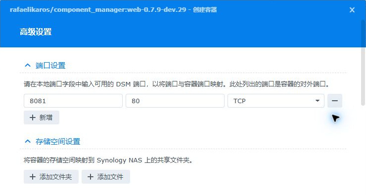

# 群晖手动部署

在 Container Manager 的「映像」中分别运行 API 和 Web 即可。以下步骤全程使用 DSM 界面，无需 Compose、`.env`、SSH、Web Station 或 Docker socket。如果只用 Android 同步，创建 API 容器即可。

## 1. 选择镜像

在「镜像仓库」搜索 `rafaelikaros/component_manager`，下载所选渠道的镜像。

| 渠道 | API 使用的标签 | Web 使用的标签 | Web 的「命令」 |
| --- | --- | --- | --- |
| 开发版（dev.30 起） | `dev` | `dev`，直接复用已经下载的镜像 | 填 `web` |
| 正式版 0.7.8 | `latest` | `web-latest` | 留空 |
| 固定 dev.30 | `0.7.9-dev.30` | `0.7.9-dev.30` | 填 `web` |

若仓库搜索报错，打开「映像 → 操作 → 导入 → 从 URL 添加」，输入 `https://hub.docker.com/r/rafaelikaros/component_manager`，选择目标标签。公开镜像无需填写 Docker Hub 用户名和密码，保留证书验证。等待镜像出现在「映像」后再创建容器。

旧部署可以继续使用配套的 `web-*` 兼容标签和默认 Web 命令。创建新开发版容器时，只需要表中的一个统一镜像。

## 2. 创建 API 容器

新安装先在 File Station 创建 `/docker/component-vault/data`。升级时，先按[手动更新步骤](#5-手动更新或切换渠道)备份并记录原映射，然后继续使用原数据目录。

1. 在「映像」选中 API 镜像，点「运行」。容器名可填 `component-vault-api`。可勾选「启用自动重新启动」，保持「通过 Web Station 设置网页门户」未勾选。
2. 在「高级设置 → 端口设置」填本地 `8787`、容器 `8787`，类型 `TCP`。在「存储空间设置」选择数据目录，装载路径填 `/data`，选「读取/写入」。

   

3. 网络选择 `bridge`，保持高权限关闭。新安装保留镜像自带的环境变量。「执行命令」中的 Entrypoint 保留默认值，「命令」留空。统一镜像会执行默认的 `api`。
4. 核对摘要，保持「向导完成后运行此容器」勾选，点「完成」。打开 `http://NAS地址:8787/health`。看到 `"status":"ok"` 后再继续。

## 3. 创建 Web 容器

1. 在「映像」中再次点「运行」。开发版选刚才创建 API 的同一个镜像，正式版选 `web-latest`。容器名可填 `component-vault-web`。保持 Web Station 和高权限关闭。
2. 在「高级设置 → 端口设置」只保留本地 `8081` → 容器 `80`（TCP）。若向导预填 `8787` 或 `8790`，把容器端口改成 `80` 或删除预填行后新增。Web 容器的「存储空间设置」留空。

   

3. 网络选择 `bridge`。保留默认 Entrypoint。**统一镜像在「执行命令 → 命令」明确填 `web`。** 使用正式版 `web-latest` 时留空，使用镜像自带的 Web 命令。
4. 核对摘要并启动。在「容器」列表确认两项都在运行，且「项目」一栏都是 `-`。访问 `http://NAS地址:8081/`，应显示管理台登录页。

| 摘要应显示 | API | Web（统一镜像） |
| --- | --- | --- |
| 本地端口 → 容器端口 | `8787 → 8787` | `8081 → 80` |
| 存储空间 | 数据目录 → `/data`，读写 | 无 |
| 命令 | 默认 `api` | `web` |

截图取自 DSM 实机。表格中的命令和标签适用于上方所选版本。宿主端口已占用时，选另一个空闲的本地端口，保持容器端口不变。后续访问地址和允许来源使用你选的本地端口。

## 4. 在网页保存配置

1. 打开 `http://NAS地址:8787/setup`，在首次设置页生成或填写管理员 API Token，并将它保存在安全的位置。新安装无需添加 `API_TOKEN` 环境变量。
2. 展开「Web 管理台（可选）」。管理台地址填 `http://NAS地址:8081/`，允许访问 API 的 Web 来源填 `http://NAS地址:8081`（末尾无 `/`）。需要从管理台编辑、删除或出入库时，开启「允许已登录的 Web 用户修改库存」，然后保存。
3. 打开 `http://NAS地址:8081/`。API 地址填 `http://NAS地址:8787`，使用刚保存的密钥登录。Android 也填写 API 地址及对应的账户密钥。

   

Web 和 API 使用同一主机名及协议，端口可以不同。允许来源填写浏览器实际打开的 Web 地址。旧部署配置了非空环境变量时，以环境变量的值为准。账户创建及密钥分发见[账户指南](accounts.md)，更多连接细节见[配置说明](docker-quickstart.md#3-环境变量和网页配置的优先级)。

## 5. 手动更新或切换渠道

1. 在容器详情导出 API 与 Web 的容器设置，记录当前标签、Image ID、端口、挂载来源和自定义环境变量。导出的设置可能含密钥，请存放于私有目录。
2. 暂停写入并停止旧 API，备份完整的宿主数据目录。备份应包括所有账户的数据库、`users/`、`config.json`、`.db.photos/` 目录以及存在的 SQLite 辅助文件。导出容器设置不包含这些文件。
3. 按第 1 节下载目标渠道。停止旧 Web，用新镜像重新创建两个容器，使用原端口、挂载和生效的自定义配置，并按目标镜像填写命令。如果旧容器还占着名称，给新容器取不同的名称，验收前保留停止的旧容器。仅点「重新启动」会继续使用旧镜像。同一个数据目录只能由一个 API 容器写入。
4. 访问 `/health` 核对版本，登录 Web 检查账户和库存。若出现首次设置或库存为空，先暂停操作并检查旧数据目录是否正确挂载。确认新容器可用后，可清理旧容器或无引用的镜像，保留数据目录和备份。

降级前先确认目标版本能读取现有数据。需要回退数据库时，使用对应版本的镜像与升级前的一致备份。[备份与回退](docker-quickstart.md#6-升级前备份与回退)

## 分阶段排障

| 现象 | 先核对什么 |
| --- | --- |
| 仓库搜索失败或下载失败 | 第 1 节的 URL 导入可绕过搜索入口。下载也失败时查看 NAS 网络和原始拉取错误。已经存在的旧镜像不会因拉取失败而消失。 |
| Web 容器退出，日志是 `exec /usr/local/bin/componentvault-entrypoint: no such file or directory` | 记录故障容器和所选映像的 Image ID，核对实际 Entrypoint、命令及挂载。用同一镜像、空闲宿主端口和第 3 节配置另建独立 Web 容器对照，无需挂载 API 数据。 |
| Web 页打不开 | 核对 Web 容器正在运行、宿主端口映射到容器 `80`。统一镜像的命令应为 `web`。 |
| Web 能打开，登录或连接失败 | 先从同一浏览器打开 API 的 `/health`，再核对密钥、API 地址和允许的 Web 来源。[连接与 Cookie 说明](docker-quickstart.md#3-环境变量和网页配置的优先级) |

dev.30 已在 DSM 用 `dev` 镜像实测独立容器启动。API 健康检查返回对应版本，Web 登录页和静态资源可访问。遇到故障请提供 DSM 版本、CPU 架构、映像 Image ID（与容器 ID 不同）、实际 Entrypoint/命令、挂载目标和完整错误行。发出截图前遮盖密钥和敏感配置。

## 6. 网页一键更新是可选项

管理台可检查版本。独立容器的镜像更新按第 5 节在 DSM 操作。需要在网页上重建容器时，请使用 Compose 项目和[可选 Updater](server-web-update.md)。Updater 需要 Docker socket；Watchtower 也需要 Docker 管理访问。
