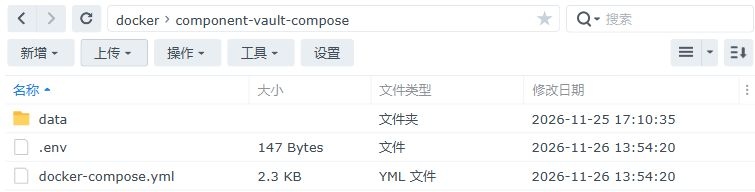
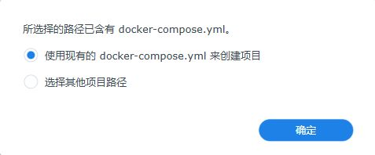
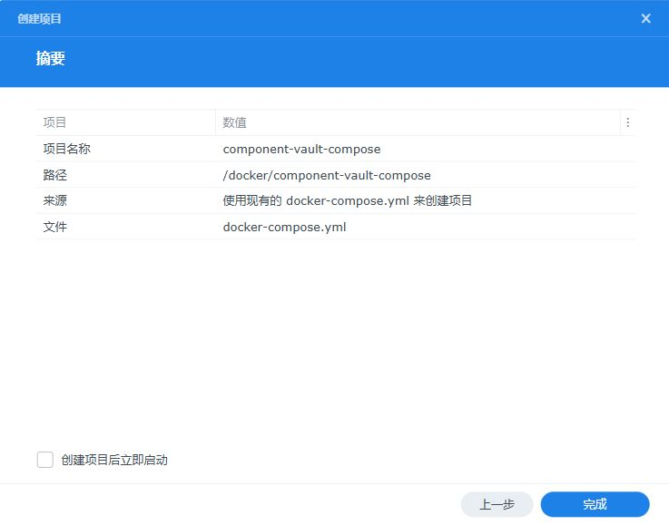
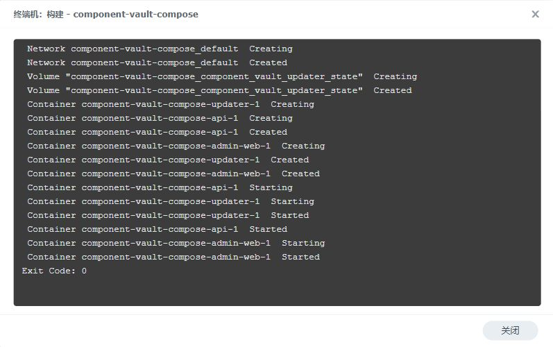
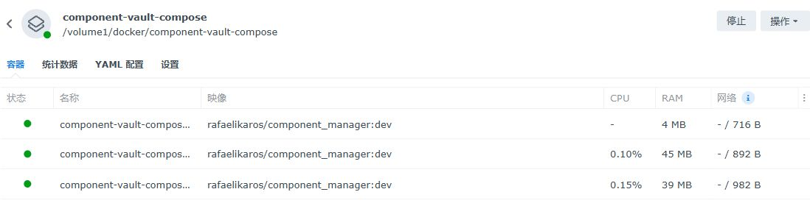
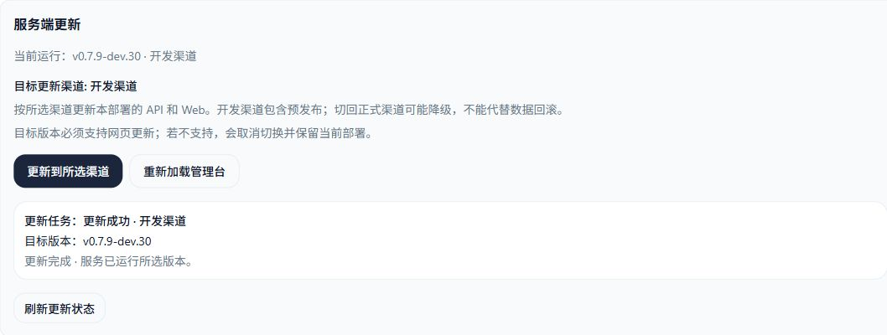

# 在网页中更新服务端

Updater 是可选的第三个容器。它面向 **Compose 项目**，管理员可从「设置 → 关于服务端」发起更新。普通部署可以直接检查版本；采用 DSM 独立容器时，按[手动更新](docker-manual.md#5-手动更新或切换渠道)替换镜像。

| 当前部署 | 怎么更新 |
| --- | --- |
| DSM 独立容器 | 在 Container Manager 拉取并替换 API、Web |
| 普通 Compose 项目 | 在原项目拉取并重新部署，或按本页启用 Updater |
| 已启用 Updater 的兼容项目 | 管理员在网页选择渠道并确认更新 |

当前正式版 0.7.8 不支持网页一键更新。它可以保留原数据升级到开发版。更新器需要宿主机的 Docker socket，在典型 root 模式下具备管理主机容器的能力。仅在接受这项权限时启用。[Docker 权限说明](https://docs.docker.com/engine/security/)

## 已有正式版先升级到 dev

从 0.7.8 升级时，在同一个 Compose 项目里更换镜像和启动命令，保留原 `/data`、密钥、端口、网络和其它实际生效的配置。可在这次编辑中同时启用 Updater，也可以按[普通部署步骤](docker-quickstart.md#使用统一镜像)只升级 API 与 Web。

先停 API，备份完整 `/data`，另存原 Compose 和 `.env`。若升级后出现首次配置或空库存，先检查项目名和数据映射。旧部署的非空环境变量会继续优先生效。变更这些覆盖值前，确认持久配置已经保存对应内容。[配置优先级](docker-quickstart.md#3-环境变量和网页配置的优先级)

## 使用统一镜像

dev.30 起使用[统一镜像更新模板](../docker-compose.hub-web-update.yml)。API、Web 和 Updater 共用同一个标签。模板让 API 使用默认 `api` 命令，Web 执行 `web`，Updater 执行 `updater`。

已有项目迁移时，在原模板中保留项目配置并合入统一镜像对应的 `image`、`command` 和 API 布局标签 `io.componentvault.compose-layout: unified`。需要跟随开发渠道时，取消残留的固定 `COMPONENT_VAULT_IMAGE` 和 `COMPONENT_VAULT_WEB_IMAGE` 覆盖。旧项目仍可使用配套 `dev` 与 `web-dev` 兼容标签。当前统一布局切回 0.7.8 需在宿主机使用旧版模板，网页会拒绝不兼容镜像。

## 群晖一次性配置

下面以 DSM 实机上的 `component-vault-compose` 为例，新建一个带 Updater 的开发版项目，并从旧备份恢复库存。已有正常运行的 Compose 项目应在原项目修改，保留原名称、路径和数据映射。

### 1. 准备项目文件

在 File Station 的 `docker` 共享文件夹下新建 `component-vault-compose`。把[统一镜像更新模板](../docker-compose.hub-web-update.yml)保存为 `docker-compose.yml`，在同一目录放置 `.env`：

```dotenv
COMPOSE_PROJECT_NAME=component-vault-compose
COMPONENT_VAULT_DEPLOY_DIR=/volume1/docker/component-vault-compose
COMPONENT_VAULT_DOCKER_CHANNEL=dev
```

项目名必须和稍后在 Container Manager 填的名称一致。File Station 显示共享路径 `/docker/component-vault-compose`，`.env` 中填写带卷名的**宿主机绝对路径**。如果你的共享文件夹在其它卷，按实际路径填写。

`.env` 是部署目录中的实际文件。Updater 通过它读取和保存镜像渠道。新安装的管理员 Token 在 `/setup` 设置，恢复已有配置时沿用备份中的密钥。Docker Hub 公开镜像无需填写仓库凭据。



### 2. 选择数据来源

- **空库新装**可以继续使用模板里的 `component_vault_data` 命名卷。
- **从文件备份恢复**时，在启动前将备份的完整 `data` 目录复制到新项目下，与 YAML 和 `.env` 同级。检查 `data/component_vault.db`、`data/config.json`、`data/users/` 以及备份中存在的照片和 SQLite 辅助文件，避免多套一层 `data`。源备份单独保留。
- **已有 Compose 更新**时，先停止旧 API 写入，备份整份 `/data`，并保留原端口、数据卷、项目文件以及生效的环境设置。项目目录之外还有 Compose 或配置文件时，需要在 Updater 中保留可访问的相同绝对路径。

如果数据放在新项目的宿主目录，把模板中两处 `component_vault_data` 挂载换成下表对应的行，并移除末尾未使用的 `component_vault_data` 卷声明。保留 Updater 的任务卷。

| 服务 | 需要的挂载 |
| --- | --- |
| API | `/volume1/docker/component-vault-compose/data:/data`，读写 |
| Web | 无数据挂载 |
| Updater | `/volume1/docker/component-vault-compose/data:/data:ro`，与 API 使用同一个来源 |
| Updater | `/var/run/docker.sock:/var/run/docker.sock`，用于重建容器 |
| Updater | `component_vault_updater_state:/state`，保存任务状态 |
| Updater | 宿主项目目录读写挂载到容器内同一绝对路径，保留模板中的 `COMPONENT_VAULT_DEPLOY_DIR` 映射 |

API 和 Updater 使用同一项目网络，API 保留 `UPDATER_URL: http://updater:8790`。API 会在数据目录生成内部通信所需的文件，Updater 从只读挂载中读取。Updater 不需要对外映射端口。模板中的 Watchtower 排除标签保持为 `false`，以免两个更新器同时替换 API 和 Web。

### 3. 让 DSM 使用现有 YAML

1. 打开「Container Manager → 项目 → 新增」，项目名称填 `component-vault-compose`。点「设置路径」选 `/docker/component-vault-compose`。
2. DSM 发现目录已有 `docker-compose.yml` 时，选择「使用现有的 docker-compose.yml 来创建项目」，确认后点「下一步」。

   

3. 保持 Web Station 网页门户未勾选，在摘要核对项目名、路径和文件。端口空闲时可保留「创建项目后立即启动」。若要替换正在占用 `8787` 和 `8081` 的旧容器，先取消立即启动，再点「完成」。

   

4. 采用延后启动时，先停止占用端口的旧 API 和 Web。回到「项目」选中新项目，点「操作 → 构建」。**新项目显示 0 个容器时，「启动」是灰色的，首次要用「构建」。** 构建窗口应显示三个容器均已启动、退出码为 `0`。

   

保留 DSM 实际使用的 Compose 文件名与路径，Updater 按项目的真实工作目录查找文件。已有老项目如果用了 `docker-compose.web-update.yml` 作为第二份配置，迁移时先保留旧文件，等原项目用完整模板重建且验证通过后再移除。[群晖项目管理](https://kb.synology.com/zh-cn/DSM/help/ContainerManager/docker_project?version=7)

命令行等价操作是在项目目录执行 `docker compose -f docker-compose.yml pull` 和 `docker compose -f docker-compose.yml up -d`。使用其它 YAML 文件名时传入实际路径，已有项目沿用原项目名。

### 4. 登录并验收

1. 在项目详情的「容器」页确认 API、Web 和 Updater 都在运行。打开 `http://NAS地址:8787/health`，确认 `status` 是 `ok` 且版本正确。

   

2. 空库新装时，在 `http://NAS地址:8787/setup` 首次设置管理员密钥。恢复了 `config.json` 的部署沿用原密钥。管理台地址通常是 `http://NAS地址:8081/`，「允许访问 API 的 Web 来源」单独填 `http://NAS地址:8081`。打开管理台时，登录页的 API 地址填 `http://NAS地址:8787`。[首次设置截图](docker-manual.md#4-设置管理员并登录)
3. 验证账号、库存、流水和 BOM 预设是否与备份一致。进入「设置 → 关于服务端」，确认能看到「更新到所选渠道」，再检查开发渠道。验收前保留已停止的旧容器，确认通过后再清理容器本体。

## 从独立 Updater 镜像迁移

旧 `updater-dev` 容器可以继续服务于与其兼容的项目。升级到 dev.30 起的统一布局时，按[统一镜像步骤](#使用统一镜像)迁移，并用 `updater` 命令重建原 Updater，沿用原 `/state` 和其它挂载。

若必须固定到 dev.29，可用 [dev.29 完整模板](https://github.com/Rafael-Ikaros/Component_Manager/blob/v0.7.9-dev.29/docker-compose.hub-web-update.yml)。旧布局由 API 镜像和配套 `web-*` 镜像组成，Web 使用默认命令，Updater 从同一个 Web 镜像启动并指定 `updater`。共享管理镜像从 dev.8 开始支持 Updater。迁移完成后可从宿主 `.env` 移除旧的 `COMPONENT_VAULT_UPDATER_IMAGE` 覆盖。

## 日常网页操作

1. 管理员进入「设置 → 关于服务端」，选择渠道，点击「检查更新」查看目标版本。
2. 点击「更新到所选渠道」，核对目标和备份提示并确认。Updater 先拉取镜像并检查版本与角色，然后备份 `.env`，重建 API 和已部署的 Web。它自身继续运行。
3. 短暂断线后页面会重新连接。完成时核对 `/health`、登录和库存。更新 Updater 自身时仍从原项目手动部署，等待进行中的任务完成。

下图是 DSM 实际完成的 dev.30 同版本更新。API 与 Web 重建后重新上线，Updater 持续运行，恢复的库存与流水保持一致。确认框可能显示兼容标签 `dev / web-dev`，使用统一模板的项目仍按自身布局共用 `dev` 镜像。



拉取或镜像校验失败时，原容器会继续运行。重建开始后若服务一直未恢复，查看 DSM 中 API 与 Updater 的日志。更新任务记录在 `/state`，可重复执行同一更新或在宿主恢复原配置。`.env.before-channel-*` 只备份部署配置，需要恢复库存时使用之前备份的整个 `/data`。

命令行维护仍可用[部署切换助手](docker-channels.md)。目标版本使用旧镜像布局时，请在宿主用相应模板回退，并先核对数据库兼容性。
